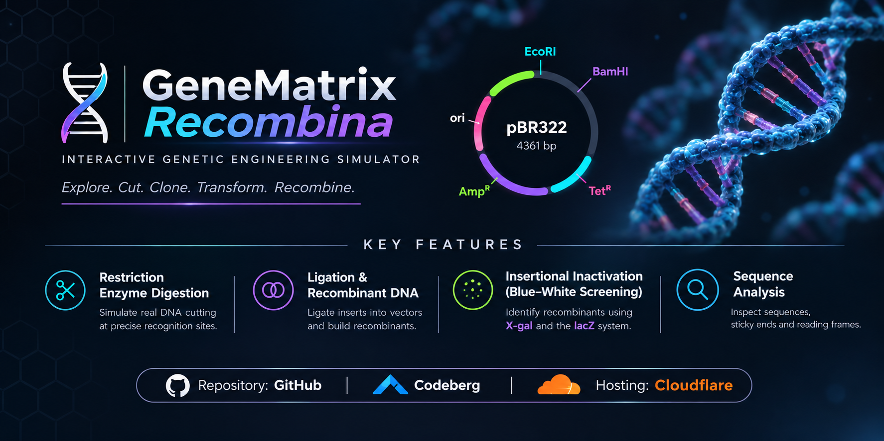

  

<h1 align="center">GeneMatrix Recombina</h1>

<i>An interactive recombinant DNA laboratory — from restriction cut to recombinant selection</i>

<b><a href="https://genematrix-recombina.stark-kodex.workers.dev/">Initiate Gene Modification</a></b>

  <a href="#about">About</a> ·
  <a href="#screenshots">Screenshots</a> ·
  <a href="#stages">Stages</a> ·
  <a href="#controls">Controls</a> ·
  <a href="#technology">Technology</a> ·
  <a href="#credits">Credits</a> ·
  <a href="#license">License</a>

---

## About

GeneMatrix Recombina lets students make recombinant DNA step by step. Cut a plasmid and a gene with the same enzyme, join them with DNA ligase, and watch it happen on a 3D DNA helix.

Then put the new DNA into bacteria and find which colonies took it up — using antibiotic markers or blue–white screening.

## Screenshots

<table>
  <tr>
    <td width="50%" align="center"> <b>1 · Meet GeneMatrix</b></td>
    <td width="50%" align="center"> <b>2 · Explore pBR322</b></td>
  </tr>
  <tr>
    <td width="50%" align="center"> <b>3 · Visualise Ligation</b></td>
    <td width="50%" align="center"> <b>4 · Spot Recombinants</b></td>
  </tr>
</table>

<b>More screenshots</b>

 
<table>
  <tr>
    <td width="50%" align="center"> <b>5 · Gene Recombination</b></td>
    <td width="50%" align="center"> <b>6 · Replica Plating</b></td>
  </tr>
  <tr>
    <td width="50%" align="center"> <b>7 · Explore in a Unique Way</b></td>
    <td width="50%"></td>
  </tr>
</table>

## Stages

| Stage | What You See | Tap to Explore |
| --- | --- | --- |
| Living Dish | 3D agar plate flies down into a dish of swimming, dividing *E. coli* | A bacterium, then its glowing plasmid |
| Plasmid Analysis | pBR322 map with ampR, tetR, ori, rop; base strip coloured by gene region | Any 6 bases; any gene or cut site on the map |
| Restriction Cut | Enzyme scans the duplex, clamps the site and makes a staggered or blunt cut | Restrict |
| Gene of Interest | Gene cut with the same enzyme; matching sticky ends compared | 6 bases, then Cut |
| Ligation | 3D helix; atomic zoom shows A·T (2) and G·C (3) hydrogen bonds; ligase seals 4 nicks | Bring the ends together · Seal with DNA ligase · Atoms |
| Transformation | Heat shock at 42 °C; only a few cells take up a plasmid | Put it into bacteria |
| Selection | Ampicillin / tetracycline plating with replica plating, or blue–white screening | Plate · Replica-plate · method tabs |
| Recombinants | Colony legend; each colony's ligated DNA and marker-gene state | A colony, then its plasmid |

**Concepts:** Restriction enzymes · Sticky and blunt ends · Annealing · Hydrogen bonds · Phosphodiester bond · DNA ligase · Vector pBR322 · Transformation · Selectable markers · Insertional inactivation · Replica plating · Blue–white screening · Nucleoid

## Controls

| Control | Function |
| --- | --- |
| Tap a cell | Zoom into the bacterium; tap its plasmid to analyse the DNA |
| Tap bases | Select a 6-base restriction site on the top strand |
| Tap the map | Show details for a gene or cut site; tap again to close |
| Drag the helix | Rotate the 3D DNA; Atoms switches to the ball-and-stick view |
| Method tabs · ↺ | Choose antibiotic or blue–white screening; repeat the transformation |
| © | Credits for the project, 3D models and data |

## Technology

HTML · CSS · JavaScript · Canvas 2D · three.js · WebGL · Web Audio · Cloudflare Pages

<b>Project files</b>

| File | Contents |
| --- | --- |
| `index.html` | Page structure, font links, three.js import map |
| `css/style.css` | All styles and layouts |
| `js/app.js` | Dish, cutting, ligation, transformation, selection, colony views |
| `js/hero.js` | 3D agar-plate intro |
| `js/dna3d.js` | 3D double helix and atomic view |
| `assets/petri-dish.glb` | Agar plate model (meshopt-compressed) |
| `banner/` · `screenshots/` | README images |

## Credits

| Contributor | Role |
| --- | --- |
| Sai Prasad, M.Sc. Agri. Entomology, ASRB NET | Project Designer |
| Claude Opus 5.5 | Development |
| OpenAI GPT Luna 5.7 | Image Generation |
| Perplexity Sonar 2 | Scientific Reasoning |

<b>3D models</b>

| Asset | Model | Creator | Licence |
| --- | --- | --- | --- |
| Intro plate | [Microbial Culture (petri dish – agar plate)](https://sketchfab.com/3d-models/microbial-culture-petri-dish-agar-plate-a760d477c4564ac98d38ce11c5be8215) | Ioannis Stavridis | CC BY 4.0 |
| Helix style reference | [DNA](https://sketchfab.com/3d-models/dna-547d42f6c0184232a945051b6952a39e) | LucasPresoto | CC BY 4.0 |
| Atomic view reference | [dna](https://sketchfab.com/3d-models/dna-eee1f1afd4fb4cb2983f04cc122e1bf3) | andrey6475u | CC BY 4.0 |

The intro plate was modified (agar recoloured, hidden parts removed, compressed). Atomic geometry follows PDB 1BNA (Drew & Dickerson, 1981) with standard base frames (Olson et al., 2001). All models used under CC BY 4.0 with attribution.

<b>Libraries and fonts</b>

| Component | Licence |
| --- | --- |
| three.js r170 | MIT |
| IBM Plex Sans · IBM Plex Mono | SIL Open Font License 1.1 |
| Roboto · Roboto Mono (fallback) | SIL Open Font License 1.1 |

## Releases

| Release | Title | Date |
| --- | --- | --- |
| RC I | Living Lab | 16 Nov 2026 |

## License

Released under the GNU General Public License v3.0 — see [LICENSE](LICENSE).

---

<a href="https://github.com/Dray-Ashcroft/Genematrix-Recombina">GitHub</a> · Codeberg | Hosted on Cloudflare Pages

